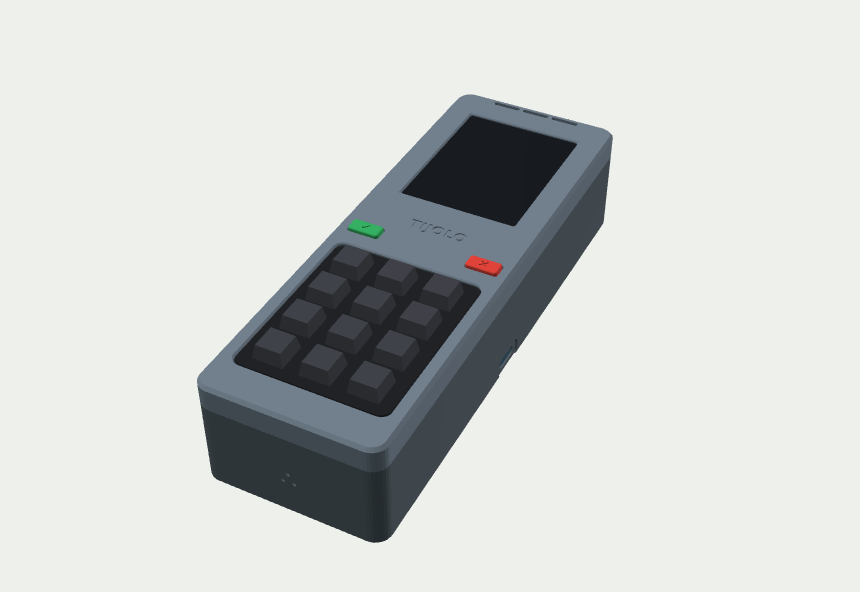

# Montagem do Tijolo: PCB da frente e caixa 3D

O Tijolo fechado numa caixa impressa em 3D, sem fios soltos. Uma PCB encomendada encaixa direto nos pinos da LILYGO e leva
a tela, os botões verde e vermelho e a ligação do teclado. O teclado 3×4 entra inteiro, sem abrir. Sobram dois cabos (o do
alto-falante e o do microfone) e a antena.



- **Para montar**: o passo a passo está no [guia](https://claude.ai/artifact/CuJ8r7VZzr5Dn8WH7geubx), com as medidas das
  peças, o que comprar, como encomendar a PCB, como imprimir e a vista 3D.
- **Os arquivos prontos** estão em [`fabricar/`](fabricar/LEIA-ME.md): os Gerbers da PCB e os STL da caixa.
- **Esta pasta** tem os scripts que geram a PCB, a caixa e o guia: mudando uma medida em `projeto.py`, tudo se refaz igual.

## Como fica

- **A LILYGO vai de costas.** Os pinos dela estão soldados do lado da pilha e ficam assim. Os componentes olham para o fundo
  da caixa; a pilha e os pinos, para a frente. A ponta da ESP32 fica para baixo e os USB-C saem pela lateral direita. Dois
  pilares do fundo têm pino, que entra nos furos dela (Ø 2,55), e os outros dois recebem parafusos M2 × 5.
- **A PCB da frente** (51,5 × 82,7 mm, 0,8 mm) encaixa nos pinos com duas barras fêmea de perna longa e passa 0,6 mm acima
  da pilha. Nenhuma solda fica em cima da pilha: o script confere.
- **A tela** é soldada na PCB pelos próprios pinos, com os pinos para baixo, que é a posição normal dela (rotação 0). Os
  quatro pinos do toque que cairiam em cima da pilha são cortados; no lugar deles a PCB tem furos sem cobre, que escondem os
  toquinhos. A ponta de cima da tela apoia em duas torres do fundo, ao lado do alto-falante.
- **O teclado** fica colado na PCB com fita dupla face de espuma. A aba dos contatos se liga à PCB por 7 perninhas de fio.
  A frente cobre a aba de fora dele (a dos 4 furos): pela abertura só passa a parte alta, com as teclas.
- **O som** sai por três fendas na frente, acima da tela. O alto-falante fica em pé no alto da caixa, virado para a parede
  de cima, num canto fechado por uma parede; o som sobe por trás da ponta da tela.
- **O USB-C** de carregar aparece num rebaixo da lateral direita, por um furo do tamanho da ponta do cabo.
- **A frente sai inteira** (duas linguetas em cima, dois parafusos M2 × 8 embaixo) e o conjunto PCB + tela + teclado desencaixa
  dos pinos para trocar a pilha.
- **A chave liga/desliga** da LILYGO fica acessível por trás, numa fenda com ON e OFF gravados.

De trás para a frente (Z, em mm, a partir da face de fora do fundo):

| Z | O quê |
|---|---|
| 0 a 1,5 | o fundo da caixa |
| 1,5 a 5,0 | os componentes da LILYGO (o mais alto, o USB-C, tem 3,2; o conector SOLAR, de 6,25, tem de sair) |
| 5,0 a 6,6 | a placa da LILYGO |
| 6,6 a 26,6 | a pilha 18650 no suporte (20,0 mm, medidos; pelo modelo 3D eram de 18,1 a 18,9) |
| 27,2 a 28,0 | a PCB da frente |
| 30,5 a 34,8 | a tela, apoiada no plástico da barra de pinos dela |
| 35,8 | a face da frente da caixa |
| 39,7 | o topo das teclas (saem 3,9 mm da caixa) |

A caixa tem 56,0 × 161,8 × 35,8 mm. Quem manda na espessura é a pilha: LILYGO mais pilha somam 21,6 mm e a
tela soma 8. A PCB tira 2,3 mm em relação ao desenho anterior, de placa ilhada (38,2 mm), e acaba com os 19 fios.
Para afinar mais, só trocando a 18650 por uma bateria chata (uns 26 mm), o que pede dessoldar o suporte.

## Os arquivos

| Arquivo | O que faz |
|---|---|
| `projeto.py` | Todas as medidas num lugar só: a LILYGO, a tela, o teclado, as alturas (Z), a PCB, a caixa, o alto-falante e o microfone. `MEDIDAS` lista as que só dá para confirmar com a peça na mão, e a faixa que serve. `python3 projeto.py` mostra um resumo. |
| `lilygo_pecas.json` | As caixas das peças da LILYGO, tiradas do modelo 3D oficial (T-A7670X-S3-Standard.step, de 26/08/2026): onde está cada peça e a altura dela, dos dois lados da placa. |
| `placa/placa.py` | A PCB (KiCad 7, pelo `pcbnew`): põe as peças, traça as trilhas, enche o GND, roda o teste de regras e gera os Gerbers para a JLCPCB, a lista de peças e as imagens. Para se alguma solda ficar em cima da pilha. |
| `placa/roteador.py` | O traçador de trilhas: grade de 0,2 mm, 2 camadas, vias, trechos a 0°, 45° e 90°. |
| `caixa/caixa.py` | A caixa (CadQuery): o fundo, a frente e os dois botões, já virados do jeito de imprimir, e versões leves para a vista 3D do guia. No fim, confere se cada peça é um sólido só e se alguma peça de dentro bate na caixa ou em outra peça. |
| `guia.py` | O guia: `saida/guia/index.html`, os desenhos da PCB e `saida/guia/3d/pecas.json` (as peças da vista 3D). |
| `empacotar.py` | Copia para `fabricar/` o que vai para a fábrica de placas e para a gráfica 3D, e faz o zip da caixa. |

O que os scripts geram sai em `saida/` (fora do git). O que vale guardar vai para `fabricar/` (no git).

## Como gerar

Precisa do Python 3.10 ou mais novo com `numpy`, `shapely` e `Pillow`, do KiCad 7 (para a PCB) e do CadQuery 2.x (para a
caixa). Da pasta `montagem/`:

```
python3 projeto.py           # o resumo das medidas
python3 placa/placa.py       # a PCB (uns 20 segundos): o KiCad, os Gerbers e o teste de regras
python3 caixa/caixa.py       # a caixa (menos de 1 minuto) e a conferência
python3 guia.py              # o guia
python3 empacotar.py         # a pasta fabricar/ e o zip da caixa
```

`caixa/caixa.py fundo`, `frente`, `botoes`, `visual`, `folgas` ou `conferir` faz só aquela parte. `folgas` lista as menores
distâncias entre a caixa e as peças.

## As medidas e de onde vieram

As peças do Felipe foram medidas em 24/11/2026 (na tabela, "medido"). Quem montar com peças de outra medida troca o valor
em `projeto.py` e gera tudo de novo.

| Peça | Medidas usadas | Fonte |
|---|---|---|
| LILYGO | placa 33,07 × 110,54 × 1,6 mm; duas barras de 16 pinos a 30,45 mm uma da outra, com o plástico do lado da pilha; 4 furos de Ø 2,55; suporte da pilha com 15 mm | modelo 3D oficial, desenho com cotas (DXF) e foto do lado da pilha, do [repositório da LILYGO](https://github.com/Xinyuan-LilyGO/LilyGo-Modem-Series/tree/main/dimensions/Standard) |
| Pilha | topo a 20,0 mm da face da placa, mais 0,6 mm de folga até a PCB | medido (pelo modelo 3D eram de 18,1 a 18,9) |
| Tela | plaquinha 42,72 × 77,18 mm; pinos a 2,00 mm da borda, o 1 (VCC) a 4,85 mm da esquerda; vidro de 10,41 a 70,67 mm; imagem 36,72 × 48,96 mm; soquete do cartão SD atrás, com 3,0 mm de altura | desenho do fabricante ([LCDWiki, MSP2401_Size.pdf](https://www.lcdwiki.com/res/MSP2402/MSP2401_Size.pdf), V1.0 de 15/04/2024) |
| Teclado | corpo 51,2 × 63,7 mm; aba dos contatos 36,2 × 5,3 mm com 9 furos a 2,54 mm; espessura 10,2 mm | corpo e espessura medidos; a aba, pela foto com cotas do anúncio e pela ficha da [Adafruit 3845](https://www.adafruit.com/product/3845) (o mesmo teclado) |
| Alto-falante | 35,3 × 25 × 6,0 mm (a calha tem 35,7 × 6,4) | medido |
| Teclado: aba de fora e parte alta | aba de fora com 3,8 mm de altura; parte alta (a das teclas) com 45,7 × 56,4 mm em cima, a 3,45 mm da borda de cima do corpo | altura e tamanho medidos; a posição, pela foto do anúncio: **conferir** |
| Microfone | Ø 9,7 × 6,7 mm | nome da peça (9767) |
| Chaves tácteis | 6 × 6 mm, 4,8 mm de altura (serve de 4,5 a 5,0) | medido |
| Barras fêmea | perna de 10,9 mm (o mínimo é 10,9: a ponta passa 0,5 mm da PCB); corpo de 8,5 mm | perna medida; o corpo é o tamanho comum |

## A PCB

Duas camadas, 0,8 mm. Na face de trás (a que olha para a pilha) ficam as duas barras fêmea e os capacitores da tela; na da
frente, a tela, as duas chaves tácteis e o teclado.

| Na PCB | Liga em | Pino da ESP32 |
|---|---|---|
| Tela: VCC, GND | J1-1 e J2-3 (3V3), GND | — |
| Tela: CS, RESET, DC | J1-4, J1-6, J1-5 | IO47, IO9, IO14 |
| Tela: SDI (MOSI), SCK, LED, SDO (MISO) | J1-13, J1-14, J1-7, J1-15 | IO11, IO12, IO36, IO13 |
| Aba do teclado, furos 2 a 8 | J2-13, J2-11, J1-10, J2-8, J2-12, J2-9, J2-10 | IO37, IO15, IO17, IO40, IO16, IO39, IO38 |
| Botão verde, botão vermelho | J1-8, J2-14 | IO35, IO21 |
| C2 (100 µF), C1 (100 nF), C4 (100 pF) | entre 3V3 e GND, ao lado dos pinos da tela | — |
| C5 (100 nF) | entre o RESET da tela e GND | IO9 |

Os pinos das barras contam a partir da ponta da ESP32 (J1 é a barra do lado da chave; J2, a do lado dos USB). O firmware
aprende sozinho qual fio do teclado é qual (`teclado aprender`), então a ordem dos 7 furos não importa. Três deles (IO15,
IO16 e IO17) são pinos que conseguem acordar a ESP32.

**Para encomendar** (JLCPCB ou parecida): envie `fabricar/pcb/tijolo-pcb-gerbers-jlcpcb.zip`, 2 camadas, espessura
**0,8 mm**, quantidade 5, acabamento HASL sem chumbo. O resto fica no padrão.

## O firmware (`MONTAGEM_PLACA 2`)

Com `#define MONTAGEM_PLACA 2` no `include/config.h`, os botões verde e vermelho passam a ser de verdade (IO35 e IO21; o
vermelho acorda a ESP32) e o teclado usa os 7 pinos da tabela acima. A tela fica na rotação 0. Depois de gravar, ensine o
teclado de novo: segure o 1 enquanto aparece "Ligando o modem…" (ou `teclado aprender` no Monitor Serial).

## Para imprimir

`fabricar/caixa/fundo.stl`, `frente.stl` (já com a cara para baixo), `botao_verde.stl` e `botao_vermelho.stl`. PETG ou PLA,
camada de 0,2 mm, 3 perímetros, 20% de preenchimento, sem suportes. Os `.step` saem em `saida/caixa/`, para quem quiser
mexer no desenho.
