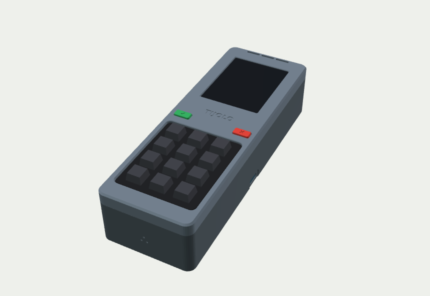

# Tijolo: arquivos para fabricar

O passo a passo da montagem está no [guia](https://claude.ai/artifact/CuJ8r7VZzr5Dn8WH7geubx). Aqui estão os arquivos que vão para a fábrica de placas e para a
gráfica 3D. Eles saem dos scripts da pasta `montagem/`; não edite à mão.

## Antes de imprimir e de encomendar

As medidas vêm dos desenhos dos fabricantes. Estas só dá para confirmar com a peça na mão, e os arquivos daqui foram feitos
com as peças do Felipe:

| O que medir | No projeto | Serve | De onde veio |
|---|---|---|---|
| Teclado: largura do corpo preto | 51,2 mm | de 50,8 a 52,0 | medido em 24/11/2026 |
| Teclado: comprimento do corpo preto, sem a aba verde | 63,7 mm | de 63,2 a 64,2 | medido em 24/11/2026 |
| Teclado: espessura, de trás até o topo das teclas | 10,2 mm | até 11 | medido em 24/11/2026 |
| LILYGO com a pilha: da face da placa (lado da pilha) até o ponto mais alto da pilha | 20,0 mm | até 20,3 | medido em 24/11/2026 |
| Tela: de frente, com os pinos para baixo, o VCC é o pino da esquerda | sim | tem de ser sim | desenho da LCDWiki; conferido em 24/11/2026 |
| Alto-falante: lado comprido × lado curto × espessura | 35,3 × 25 × 6,0 mm | lado comprido até 35,5; lado curto até 28; espessura até 6,2 | medido em 25/11/2026 |
| Teclado: altura da aba de fora, a dos 4 furos (de trás do teclado até a face de cima da aba) | 3,5 mm | até 4,5 | ficha da Adafruit 3845: CONFERIR |
| Teclado: a parte alta, onde ficam as teclas: largura × comprimento | 47,2 × 57,7 mm | largura até 48,0; comprimento até 58,5 | foto do anúncio: CONFERIR |
| Chave táctil (os botões verde e vermelho): altura, da base até o topo do botãozinho | 4,8 mm | de 4,5 a 5,0 | medido em 24/11/2026 |
| Barra fêmea de perna longa: comprimento da perna | 10,9 mm | 10,9 ou mais | medido em 24/11/2026 |

Se alguma peça sua sair da faixa, mude a medida em `montagem/projeto.py` e gere tudo de novo.

## A PCB (`pcb/`)

| Arquivo | Para quê |
|---|---|
| `tijolo-pcb-gerbers-jlcpcb.zip` | o que se envia para a fábrica (Gerbers e furação) |
| `tijolo-pcb.kicad_pcb` e `.kicad_pro` | a placa, para abrir no KiCad 7 |
| `pecas.csv` | as peças e onde vão |
| `pcb-frente.svg` e `pcb-tras.svg` | as duas faces, para conferir na bancada |

Para encomendar (JLCPCB ou parecida): 2 camadas, FR-4, **espessura de 0,8 mm**, 5 unidades, acabamento HASL sem chumbo. A
placa mede 51,5 × 82,7 mm e leva escrito **v3 · 2026-11**. Com a espessura padrão, de 1,6 mm, a caixa não fecha.

| Na placa | Peça | Lado |
|---|---|---|
| J1, J2 | barra fêmea 1 × 16 de perna longa (empilhável), 2,54 mm, perna de 10,9 mm ou mais | atrás; a solda é na frente |
| TELA | a tela 2,4" ILI9341, pelos pinos dela (os 4 marcados com X são cortados antes) | frente |
| VERDE, VERMELHO | chave táctil 6 × 6 mm, com 4,8 mm de altura, 4 pernas | frente |
| C2 | capacitor eletrolítico de 100 µF, 10 V ou mais | atrás |
| C1, C5 | capacitor cerâmico de 100 nF | atrás |
| C4 | capacitor cerâmico de 100 pF (opcional) | atrás |
| ABA DO TECLADO | 7 perninhas de fio até a aba do teclado 3×4 | frente |

## A caixa (`caixa/`)

| Arquivo | O que é | Como imprimir |
|---|---|---|
| `fundo.stl` | a metade de trás | a face de trás na mesa |
| `frente.stl` | a metade da frente | a face da frente na mesa (já está virada) |
| `botao_verde.stl` | o botão verde (✓) | em pé, como está |
| `botao_vermelho.stl` | o botão vermelho (✕) | em pé, como está |

PETG ou PLA, camada de 0,2 mm, 3 perímetros, 20% de preenchimento, **sem suportes**. A caixa fechada mede
56,0 × 161,8 × 35,8 mm.

Parafusos: 2 M2 × 8 de cabeça chata fecham a caixa, por trás. Outros 2 M2 × 5 prendem a LILYGO no fundo.
